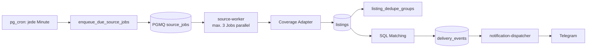

# Architektur v3

## Ziel

Eine einzige Orchestrierung für alle 65 Quellen: keine userabhängigen Portal-Suchen, keine Source-spezifischen Scheduler, keine parallelen Match-/Outbox-/Enrichment-Pipelines.

## Source Worker

`source-worker` ist die einzige produktive Source-Edge-Function. Der Worker liest `sources` und `source_connectors` und wählt den Adapter innerhalb desselben Deployments.

Coverage-Strategien:

- `adaptive_partition`: ImmoScout – 7 Bezirke, adaptive Preispartitionierung über MCP, Stadtteil nur als Fallback.
- `district_pagination`: Kleinanzeigen – 7 Bezirke plus Pagination.
- `tenant_api`: Immomio, ImmoSolve/HPM und strukturierte APIs.
- `pagination`: Resultlisten mit Seiten/Cursor.
- `full_page`: kleine vollständige Angebotsseiten.
- `availability`: Verfügbarkeits-/Booking-Systeme.
- `generic`: Quelle bleibt live, bis ein spezifischer Adapter erforderlich ist.

Die Coverage-Position liegt generisch in `source_coverage_state`; es gibt keine ImmoScout-spezifischen Inventory-Tabellen mehr.

## Scheduling

- Master Scheduler: jede Minute.
- Alle fälligen Live-Quellen werden in `source_jobs` eingereiht.
- `source-worker` verarbeitet höchstens 3 Source-Jobs gleichzeitig und zieht innerhalb seiner Laufzeit weitere Jobs nach.
- Polling: ImmoScout/Kleinanzeigen 1 min; ausgewählte große Portale 2 min; K1 typischerweise 5 min; K2 10 min; K3 30 min.
- Fehler erhalten zusätzlichen Backoff.

`sources.crawl_priority` steuert die Reihenfolge gleichzeitig fälliger Quellen. `sources.tier` bleibt die unabhängige K1/K2/K3-Kategorisierung aus der fachlichen Mastertabelle.

## Live und Shadow

`runtime_mode` ist von K1/K2/K3 getrennt. Shadow bedeutet: keine normale Crawl-/Delivery-Ausführung. Die Quelle bleibt trotzdem im 65-Quellen-Katalog in Supabase erhalten.

## Baseline

Eine Quelle darf erst nach erfolgreicher Erstinventarisierung neue Inserate zustellen. `baseline_completed_at` verhindert, dass vorhandener Altbestand beim Cutover massenhaft an Telegram gesendet wird.

## Listings, Dedupe und Delivery

`listings` ist die einzige Listing-Ingestion-Tabelle. Cross-Source-Dubletten werden über `listing_dedupe_groups` zusammengeführt; `preferred_listing_id` bestimmt das auszuliefernde Vorkommen.

Neue primäre Listings werden direkt gegen das eine aktive Suchprofil des Users gematcht und als `delivery_events` eingereiht. Es gibt keine separaten Tabellen `matches`, `notification_outbox`, `canonical_listings` oder `listing_occurrences` mehr.

`notification-dispatcher` verarbeitet `delivery_events` sequenziell je Ereignis und sendet die Telegram-Karte. Wenn ein Bild nicht verwendbar ist, fällt die Zustellung auf eine normale Textnachricht zurück statt eine zusätzliche Bild-Edge-Function zu benötigen.

## Datenbank-Kern

Die produktive Architektur besteht aus 14 Public-Kerntabellen:

- `sources`, `source_connectors`, `source_coverage_state`, `source_jobs`, `crawl_runs`
- `listings`, `listing_dedupe_groups`
- `bot_users`, `search_profiles`, `saved_listings`, `delivery_events`, `bot_events`
- `hamburg_boroughs`, `hamburg_neighborhoods`

Es gibt genau eine PGMQ-Queue: `source_jobs`.

## Cron

Vier produktive Jobs:

1. `source-scheduler-every-minute`
2. `source-worker-every-minute`
3. `notification-dispatcher-every-minute`
4. `architecture-maintenance-daily`

## GitOps

Supabase `sources` und `source_connectors` sind die Runtime-Source-of-Truth. Ein zweiter `data/source_catalog.json` wird bewusst nicht gepflegt, damit kein Konfigurationsdrift entsteht.

Produktionsschema wird über Migrationen versioniert. Die drei produktiven Runtime-Bereiche liegen in GitHub unter:

- `supabase/functions/source-worker`
- `supabase/functions/notification-dispatcher`
- `supabase/functions/telegram-ui`

Historische Migrationen bleiben erhalten. Obsolete Runtime-Implementierungen werden nach dem Cutover aus dem aktuellen Codebaum entfernt.

## Bekannte Connector-Grenzen

Architektur-Cutover und Connector-Coverage sind getrennte Zustände. ImmoScout nutzt die geprüfte MCP-Coverage-Strategie und ist damit nicht gleichbedeutend mit dem vollständigen öffentlichen ImmoScout-Webbestand. Kleinanzeigen kann bei serverseitigem HTTP-Zugriff 403 liefern; ein solcher Lauf wird als Fehler/Backoff behandelt und niemals als vollständige Baseline gewertet.
