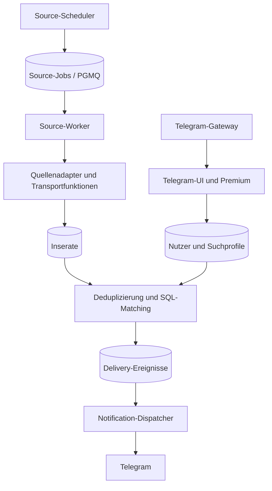

# Architektur und Betriebsstand

Stand: 5. September 2026. Detaillierte Befunde, Testgrenzen und Rollout: [Architektur-Review](ARCHITECTURE_REVIEW_2026-09-05.md).

## Verantwortlichkeiten

- `sources` und `source_connectors` bleiben die Laufzeitkonfiguration für 65 Quellen. K1/K2/K3, Live/Shadow und Polling sind separate Eigenschaften.
- `source-worker` übernimmt zentral die Jobs und wählt Quellenadapter. Transport-/Feed-Functions unterstützen einzelne Anbieter; sie haben keine eigene generische Source-Queue.
- `listings` und `listing_dedupe_groups` tragen Bestand und Dublettenpräferenz. SQL-Trigger prüfen Qualität, Baseline, Aktualität und Suchprofilbedingungen.
- `delivery_events` trägt die Zustellung; es gibt keine zusätzliche Notification-Outbox.
- Telegram- und Stripe-Eingänge authentifizieren ihre Webhooks in der Anwendung. `verify_jwt=false` allein ist deshalb kein Sicherheitsfehler.
- Premium-Rechte, Empfehlungen und bis zu drei Premium-Suchprofile sind Bestandteil der inzwischen erweiterten Runtime. Die alte Ein-Profil-Beschreibung war überholt.

## Zuverlässigkeit nach diesem PR

Source-Jobs besitzen einen zehnminütigen Visibility-Zeitraum und eine Versuchsnummer. Abgelaufene processing-Jobs werden wieder übernommen. `finish_source_job_attempt` akzeptiert nur den aktuellen Versuch; nach fünf abgestürzten Versuchen wird der Job abgeschlossen/archiviert, sodass die Quelle wieder eingeplant werden kann. Source- und Crawl-Persistierungsfehler werden weitergereicht.

Delivery-Ereignisse werden atomar von pending/failed nach processing übernommen. Versuchsnummer und Reservierungszeit schützen die Bestätigung vor veralteten Workern. Abgelaufene Reservierungen werden nach zehn Minuten zur Wiederholung freigegeben. Das schützt vor parallelem Versand desselben Ereignisses, garantiert aber kein Exactly-once über die externe Telegram-API.

Beide Worker starten nach rund 50 Sekunden keine neue Arbeit. Bereits laufende Operationen dürfen darüber hinausgehen. Drei Source-Jobs parallel gelten pro Aufruf, nicht als globale Parallelitätsgrenze.

Die Prämien-RPC ist auf die Service Role beschränkt und verlangt ein vorhandenes Suchprofil.

## Verifizierter Produktionsstand vor Rollout

54 Quellen live, 11 shadow; 23 Public-Tabellen mit RLS; 21 deployte Edge Functions. Keine Quelle hat mehr als drei aktivierte Connectoren. Es bestehen sieben aktive Cron-Jobs einschließlich der Provider-Index-Prüfungen und Premium-Ablaufprüfung.

Polling ist aktuell zwischen 1 und 60 Minuten konfiguriert; der Scheduler und Source-Retry enthalten zusätzlich Backoff. Der produktive Dispatcher besitzt keinen globalen 15-Sekunden-Takt. Die früher formulierte 5-Minuten-/15-Sekunden-Anforderung ist damit nicht umgesetzt. Dieser PR ändert diese Betriebsparameter nicht.

## Deployment

Die Dispatcher-Dateien in diesem PR basieren auf der direkt aus Supabase gelesenen Version 27, anschließend ergänzt um Reservierung und Fehlerbehandlung. Die zuvor eingecheckte Implementierung war eine andere Variante mit zusätzlichen Digest-Pfaden; deren Vorhandensein im Repository belegt keine produktive Nutzung.

Der Migrationsabgleich ist offen: 62 von 125 bisherigen Repository-Versionen fehlen als identische Schlüssel im Live-Register. Neue Migration zuerst in einer isolierten Umgebung testen, Historie abgleichen, dann Migration vor Source-Worker deployen. Den alten Dispatcher vor der Umstellung auslaufen lassen. Details im Review.

## Validierung

Node 24: `npm ci --ignore-scripts && npm test`. Die CI führt Verhaltenstests zusätzlich zu Strukturprüfungen aus. SQL-Tests verwenden synthetische Daten und ein vereinfachtes PGMQ-Modell; echte Supabase-Integration und Lasttests bleiben Bestandteil des Rollouts.
