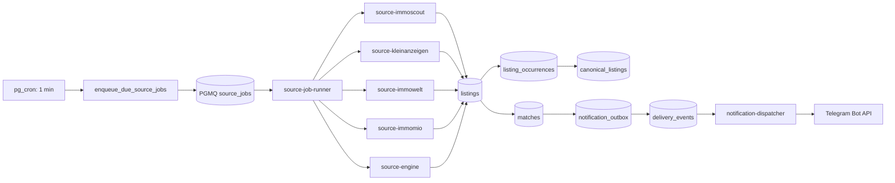

# Architektur v2

## Ziel

Die Architektur trennt Abruf, Orchestrierung, kanonische Wohnungsidentität, Profil-Matching und Telegram-Zustellung. Bestehende funktionierende Source-Adapter bleiben unverändert und schreiben weiterhin in `public.listings`.

## Datenfluss

## Zentrale Regeln

### 1. Bestehende Adapter bleiben kompatibel

`public.listings` ist die Compatibility-Ingestion-Schicht. Source-Adapter müssen für Architektur v2 nicht umgeschrieben werden. Datenbank-Trigger erzeugen daraus die neue kanonische Ebene.

### 2. Polling und Evidenz sind getrennt

- `sources.tier` / `poll_interval_minutes` = Abrufhäufigkeit.
- `source_connectors.evidence_tier` = Qualität der technischen Evidenz.
- `source_connectors.connector_role` = `primary` oder `fallback`.
- `source_connectors.enumerable` = Connector kann den vollständigen aktuellen Bestand sicher enumerieren.
- `source_connectors.shadow_only` = Ergebnisse dürfen nicht als vertrauenswürdige Live-Evidenz für Verfügbarkeitsentscheidungen dienen.

Ein schneller Poll ist nicht automatisch eine starke Evidenz und umgekehrt.

### 3. Source-Orchestrierung ist Queue-basiert

`pg_cron` führt Source-Worker nicht mehr direkt aus. Es enqueued fällige Quellen nach `pgmq.source_jobs`. `source-job-runner` claimt Nachrichten mit Visibility Timeout und ruft den bereits bestehenden Worker auf.

Retry-Backoff pro Job:

- Versuch 1: 60 Sekunden
- Versuch 2: 5 Minuten
- weitere Versuche: 15 Minuten
- nach 5 Fehlversuchen: `dead`

Die bestehenden Source-spezifischen Fehler-Backoffs in `sources.consecutive_failures` bleiben zusätzlich bestehen.

### 4. Kanonische Wohnung und Source-Vorkommen sind getrennt

`canonical_listings` repräsentiert die kanonische Wohnung. `listing_occurrences` repräsentiert das konkrete Auftreten bei einer Quelle.

Damit kann dieselbe Wohnung parallel bei Immomio, ImmoScout24 oder einer anderen Quelle vorhanden sein, ohne mehrfach als unterschiedliche Wohnung behandelt werden zu müssen.

Die bevorzugte Occurrence wird deterministisch nach Qualitätsrang und Aktualität ausgewählt.

### 5. Verfügbarkeit ist konservativ

Eine Occurrence wird nur aufgrund von Abwesenheit deaktiviert, wenn:

1. der Crawl erfolgreich war,
2. der tatsächlich verwendete Connector bekannt ist,
3. genau dieser Connector `enumerable=true` ist,
4. der Connector nicht `shadow_only` ist,
5. die Occurrence in drei vollständigen erfolgreichen Crawls nicht erneut gesehen wurde.

Ein kanonisches Listing wird erst inaktiv, wenn keine aktive Occurrence mehr existiert.

### 6. Matching und Zustellung sind getrennt

`matches` speichert die fachliche Übereinstimmung zwischen Profil und kanonischer Wohnung.

`notification_outbox` speichert die Zustellabsicht. Sie bridged in die bestehende `delivery_events`-Pipeline, sodass `notification-dispatcher` unverändert weiterarbeitet.

### 7. Mehrere Suchprofile bleiben unterstützt

Die bestehende Telegram-UI darf mehrere aktive Suchprofile verwalten. Deduplizierung geschieht auf Empfänger-Ebene in der Outbox und zusätzlich in `delivery_events`, sodass dieselbe Wohnung nicht mehrfach an denselben Telegram-Empfänger gesendet wird.

### 8. Immomio bleibt strikt

Bestätigte Immomio-Quellen verwenden den bestehenden `source-immomio`-Adapter. Gültige Angebote müssen echte `tenant.immomio.com/apply/<UUID>`-Links sein. Interessenten-/Registrierungstokens sind keine Listing-Feeds.

### 9. Sicherheit

- Public-Tabellen verwenden RLS deny-by-default.
- Source-Job-RPCs sind nur für `service_role` ausführbar.
- Secrets bleiben in Supabase; im Source-Katalog stehen keine Credentials.
- Bestehende öffentliche RPCs werden nicht erweitert; Default-EXECUTE für neue Public-RPCs ist entzogen.

### 10. Observability

Private Views:

- `app_private.queue_health`
- `app_private.source_health_v2`
- `app_private.architecture_health`

Wichtige Betriebsmetriken sind Queue-Alter, offene/dead Jobs, letzter Crawl, Trefferzahl, Fehlerzustand und aktive Occurrences.

## GitOps

`data/source_catalog.json` enthält stabile Source-Orchestrierungsdaten: ID, Name, Typ, Polling, Worker und Live/Shadow-Modus. Provider-spezifische Connector-Konfiguration bleibt in Supabase bzw. den vorhandenen Migrationen.

Produktionsänderungen an Architektur und Schema werden als Migrationen versioniert. Edge Functions werden im Repository gespiegelt. CI prüft Struktur, Source-Katalog und offensichtliche Secret-Leaks.

## Nicht eingeführt

Bewusst nicht eingeführt wurden Redis, Realtime, Partitionierung oder ein separates Cache-System. Für die aktuelle Last reichen Postgres, PGMQ, pg_cron und Edge Functions aus.
