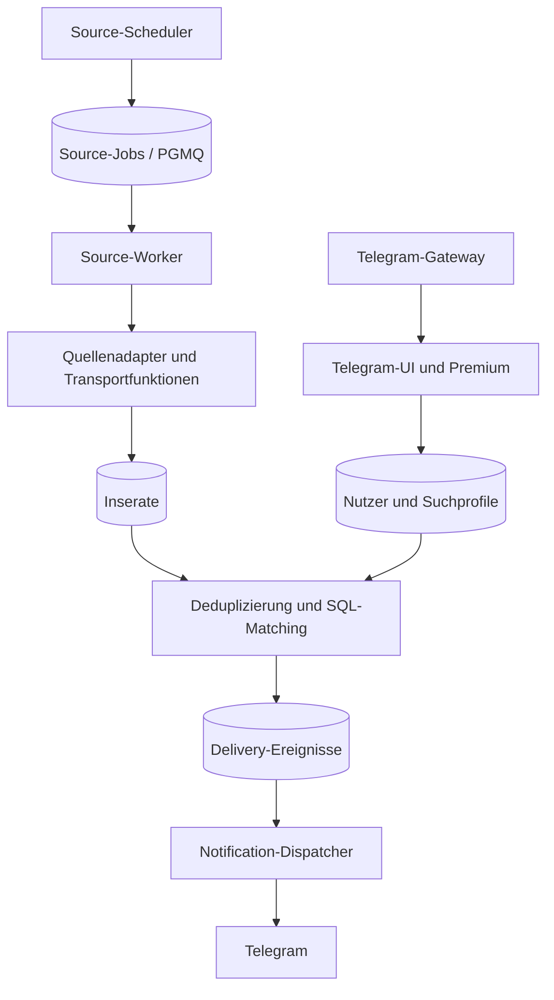

# Architektur und Betriebsstand

Stand: 5. September 2026. Aktueller Rollout und Betriebsnachweis: [Rollout](ROLLOUT_2026-09-05.md). Der [ursprüngliche Review](ARCHITECTURE_REVIEW_2026-09-05.md) dokumentiert den Vorzustand, nicht den aktuellen Deployment-Status.

## Verantwortlichkeiten

- `sources` und `source_connectors` bleiben die Laufzeitkonfiguration für 65 Quellen. K1/K2/K3, Live/Shadow und Polling sind separate Eigenschaften.
- `source-worker` übernimmt zentral die Jobs und wählt Quellenadapter. Transport-/Feed-Functions unterstützen einzelne Anbieter; sie haben keine eigene generische Source-Queue.
- `listings` und `listing_dedupe_groups` tragen Bestand und Dublettenpräferenz. SQL-Trigger prüfen Qualität, Baseline, Aktualität und Suchprofilbedingungen.
- `delivery_events` trägt die Zustellung; es gibt keine zusätzliche Notification-Outbox.
- Telegram- und Stripe-Eingänge authentifizieren ihre Webhooks in der Anwendung. `verify_jwt=false` allein ist deshalb kein Sicherheitsfehler.
- Premium-Rechte, Empfehlungen und bis zu drei Premium-Suchprofile sind Bestandteil der inzwischen erweiterten Runtime. Die alte Ein-Profil-Beschreibung war überholt.

## Zuverlässigkeit nach diesem PR

Source-Jobs besitzen einen zehnminütigen Visibility-Zeitraum und eine Versuchsnummer. Abgelaufene processing-Jobs werden wieder übernommen. `finish_source_job_attempt` akzeptiert nur den aktuellen Versuch; nach fünf abgestürzten Versuchen wird der Job abgeschlossen/archiviert, sodass die Quelle wieder eingeplant werden kann. Source- und Crawl-Persistierungsfehler werden weitergereicht.

Delivery-Ereignisse werden atomar von pending/failed nach processing übernommen. Versuchsnummer und Reservierungszeit schützen die Bestätigung vor veralteten Workern. Ein globaler Besitznachweis und ein persistierter 15-Sekunden-Sendezeitpunkt koordinieren mehrere Aufrufe. Abgelaufene Reservierungen und mehrdeutige Telegram-Antworten werden als `delivery_outcome_unknown` markiert und nicht automatisch erneut gesendet. Das vermeidet riskante Wiederholungen, garantiert aber kein Exactly-once über Telegram.

Beide Worker starten nach rund 50 Sekunden keine neue Arbeit. Bereits laufende Operationen dürfen darüber hinausgehen. Drei Source-Jobs parallel gelten pro Aufruf, nicht als globale Parallelitätsgrenze.

Die Prämien-RPC ist auf die Service Role beschränkt und verlangt ein vorhandenes Suchprofil.

## Verifizierter Produktionsstand nach Rollout

54 Quellen live, 11 shadow; 22 Function-Snapshots einschließlich zweier stillgelegter Mini-App-Endpunkte mit HTTP 410. Keine Quelle hat mehr als drei aktivierte Connectoren. Zehn Cron-Jobs sind aktiv, einschließlich Inbox-Recovery und Shadow-Prüfungen. UI-Code liegt als lesbare Module vor; Inbox-Claims und idempotente Saved-Toggles erlauben kontrollierte Wiederaufnahme.

Alle 65 Quellen sind auf fünf Minuten Polling konfiguriert; nur aktivierte Live-Quellen werden regulär abgearbeitet. Source-Backoff entfällt. Der Dispatcher wartet global mindestens 15 Sekunden zwischen regulären Zustellungen. Bei großem Rückstau dauert das Abarbeiten entsprechend länger.

## Deployment

Die Dispatcher-Dateien in diesem PR basieren auf der direkt aus Supabase gelesenen Version 27, anschließend ergänzt um Reservierung und Fehlerbehandlung. Die zuvor eingecheckte Implementierung war eine andere Variante mit zusätzlichen Digest-Pfaden; deren Vorhandensein im Repository belegt keine produktive Nutzung.

142 Migrationen sind mit den tatsächlichen Produktionsversionen exportiert und per Hash nachweisbar. 62 historische Dateinamen wurden ersetzt, ohne die Live-Historie umzuschreiben. Zwei historische SQL-Exporte referenzieren erforderliche Zugangsdaten über Vault statt sie erneut einzuchecken. Dispatcher v30 enthält die Korrektur der am Rollouttag erkannten `owner`-Überschattung.

## Validierung

Node 24: `npm ci --ignore-scripts && npm test && node scripts/check-runtime.mjs`. 28 Verhaltenstests einschließlich vollständigem Dispatcher-Handler. Zusätzlich reales PostgreSQL/PGMQ mit Rollback sowie authentifizierte/unauthentifizierte HTTP-Proben. Kein vollständiger Lasttest und kein Nachweis vollständiger Enumeration aller externen Anbieter. Echte Versandbestätigungen nach der v30-Korrektur sind im Rolloutbericht dokumentiert.
